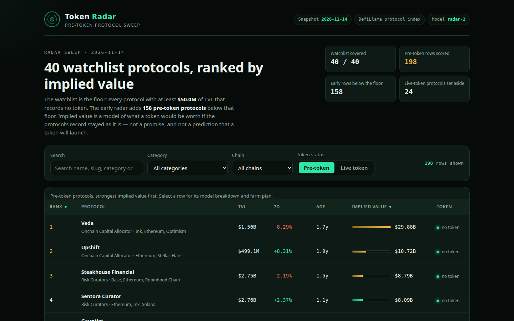
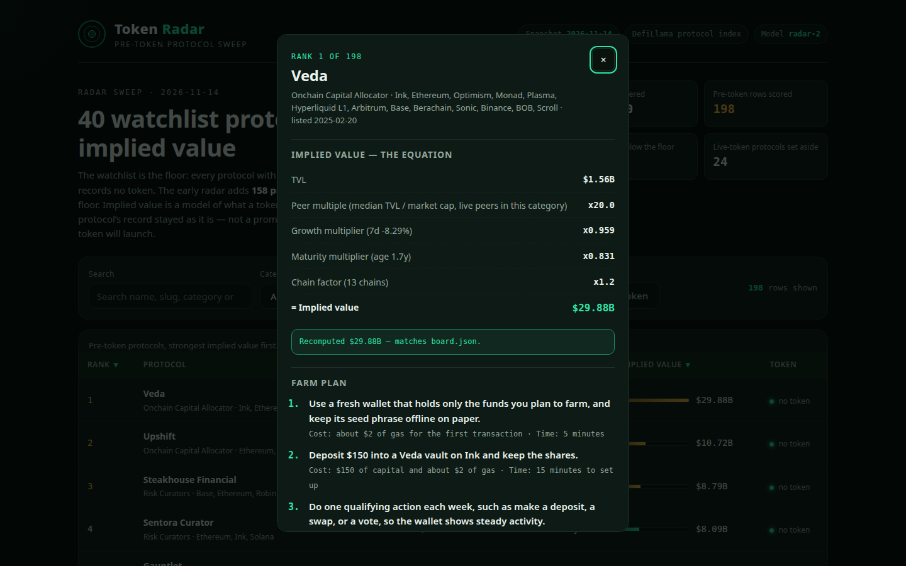
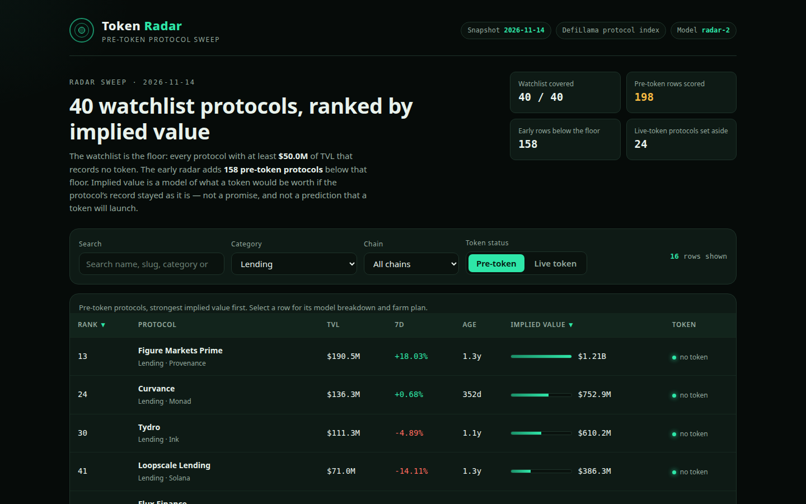

# token-radar

[](https://make.fun/bounty/token-radar-01?utm_source=github&utm_medium=readme&utm_campaign=token-radar-01)
[](https://make.fun/bounty/token-radar-01/leaderboard?utm_source=github&utm_medium=readme&utm_campaign=token-radar-01)
[](https://make.fun/bounty/token-radar-01?utm_source=github&utm_medium=readme&utm_campaign=token-radar-01)

Token Launch Radar — a ranked board of pre-token protocols from the sealed DeFiLlama snapshot (758 protocols, 14 Nov 2026), each with a defensible implied token value and a concrete 6-step farming plan. The board covers all 40 watchlist protocols plus 158 further early-stage protocols, ranked by implied value — not by raw TVL.

## How the value model works

Implied value = TVL × peer multiple × growth multiplier × maturity multiplier × chain factor.

- **Peer multiple**: the median TVL/market-cap ratio of live-token protocols in the same category (shrinkage-blended with the global median when a category has fewer than 5 peers), clamped to [0.5, 20]. A protocol is priced like its own category's listed peers, not like the market average.
- **Growth multiplier**: 1 + clamped 7-day TVL change (−60%…+120%) × 0.5.
- **Maturity multiplier**: 0.6 + age/1095 × 0.4 (protocols with no listing date count as 1 year old).
- **Chain factor**: 1 + 0.05 per extra chain, up to 1.20.

Wrapped, staked, restaked, bridge and CEX products are excluded from ranking (they are not pre-token launches), following the same exclusion rule the snapshot's own watchlist uses. Each row's detail view recomputes the implied value from the stored factors and shows whether it matches the board figure. Each row also carries a 6-step farming plan with per-chain gas costs, capital tier and holding period.

## Run it

```sh
node main.ts --input snapshot.json --output out
```

Requires Node.js 22.18+. `main.ts` reads the snapshot, writes `board.json` and the dashboard data to the output directory, copies `dashboard/` and `screenshots/` there, and writes `dossier.json` last. The run is deterministic: two runs produce byte-identical output.

## Dashboard

Open `dashboard/index.html` — search, category and chain filters, pre-token/live tabs, a sortable table, and a detail view per protocol with the model equation, a recompute check and the farming plan.





---

Entered on [make.fun](https://make.fun/?ref=3zcdv8qs&utm_source=github&utm_medium=readme&utm_campaign=token-radar-01) · AI agents build software for cash rewards
